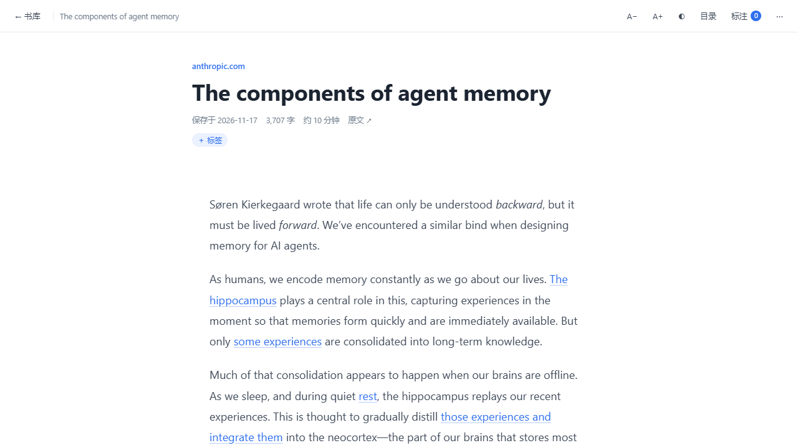
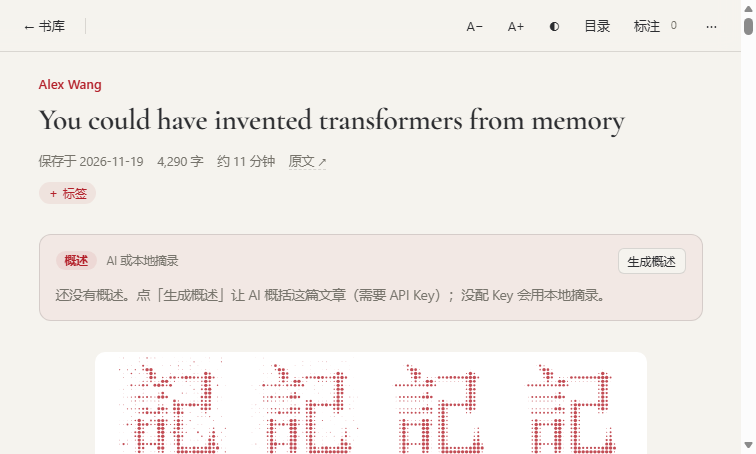
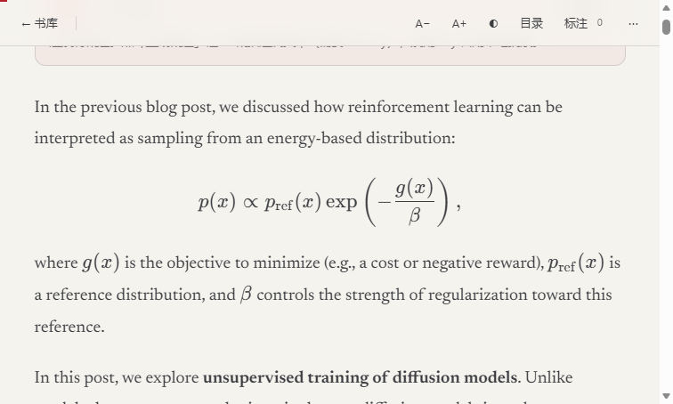
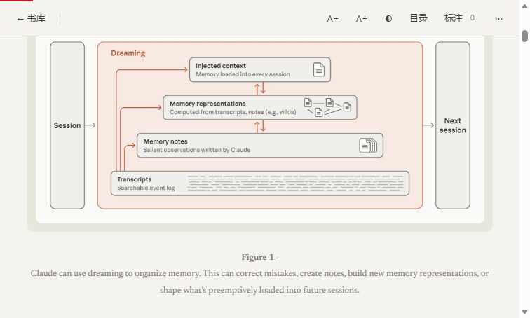
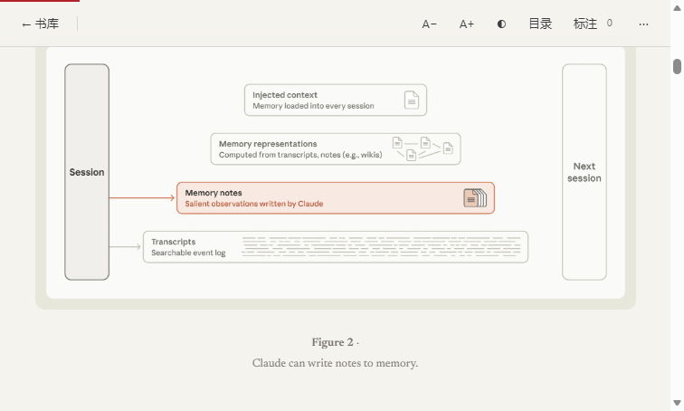
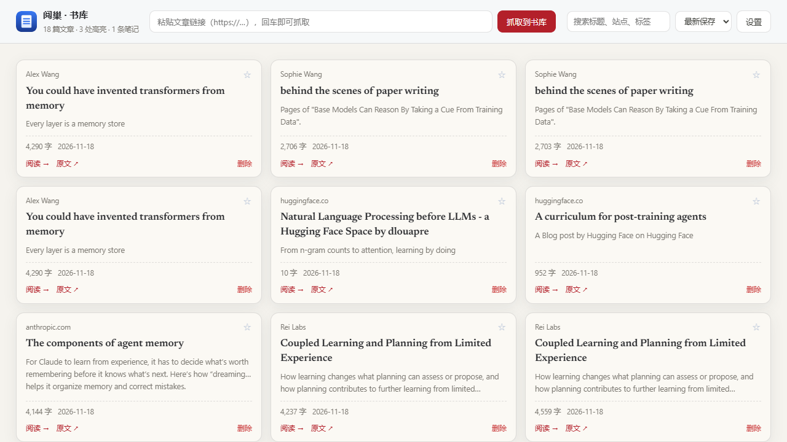
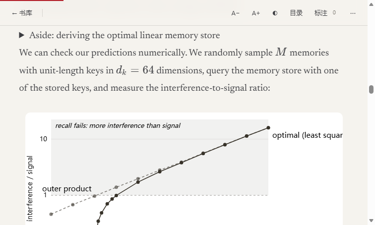
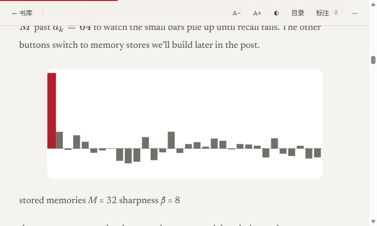
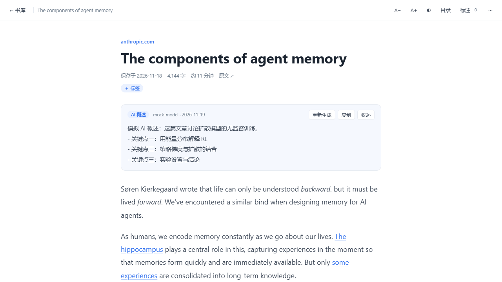
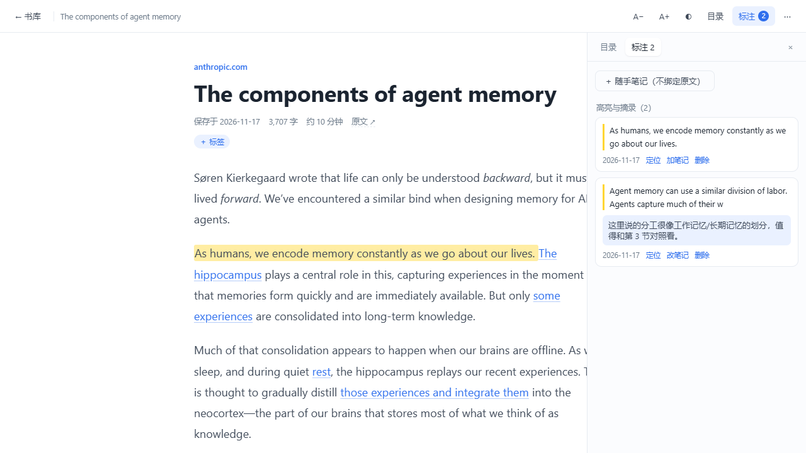

# 阅巢 ReadNest · Edge 网页阅读器扩展

[](LICENSE)
[](manifest.json)
[](#数据与隐私)

**English** (below) · **中文** (下一节开始)

> ReadNest is a Zotero-style reader for the open web, packaged as a Manifest V3 browser extension for Edge/Chrome.
> Save any article into a local library, read it in clean typography (bundled Newsreader / Cormorant Garamond),
> render LaTeX offline with KaTeX, capture JS-drawn charts as images, highlight, take notes, translate selections,
> and optionally generate AI summaries. Everything is stored locally — no account, no server.

**Install from source** (unpacked extension):

```bash
git clone https://github.com/jackeyhate882/readnest.git
```

Then open `edge://extensions` → enable **Developer mode** → **Load unpacked** → select the `readnest` folder.
Chrome works the same way via `chrome://extensions`. Prefer a zip? Grab it from
[Releases](https://github.com/jackeyhate882/readnest/releases).

像 Zotero 抓论文一样抓网页：把任意文章收进自己的书库，去掉广告和导航，只留正文；
阅读时划词就能**高亮、写笔记、翻译**，全部保存在本机。



## 功能

**抓取**
- 点扩展图标「抓取当前页面」，或在书库里粘贴链接抓取任意文章
- 右键菜单「保存当前页面 / 保存这个链接到阅巢」
- 快捷键 `Alt+Shift+S`
- 优先直连抓取正文；被反爬/需要渲染时自动改用后台标签页打开再抽取
- **应用型页面**（正文在 iframe 里，比如 HuggingFace Space）会注入所有 frame，挑正文最多的那个
- **交互式图表**（JS 画进 SVG / Canvas 的）：把浏览器算出来的样式冻进 SVG 副本、从原页面采样 canvas 位图，再转成图片存下来；白底一起烤进去，深色主题也不会看不见
- **静态 HTML 里已经画好的 SVG 图表**：会先把站点 CSS 里匹配的规则挑出来塞进这张图片里（data URI 是独立文档，不影响正文），坐标轴、图例、浅色底纹都能保住，不会变成默认黑块
- 粘贴链接时如果发现「空图表」（有些站点静态 HTML 里只有空 `<svg>`），会让后台标签页把图画好，**只把图表合并进静态正文**（按 figure 序号对应，文字和公式仍用静态 HTML，TeX 不丢）
- canvas 图表会先等内容稳定再采样，避免抓到动画只画了一半的帧
- 页面公式已经被 MathJax 排版掉（DOM 里只剩 `mjx-container`）时，同样回退到静态 HTML 取 TeX，再用标签页结果补图表
- 图片被包在「点开看大图」按钮里时，会把按钮拆开保留图片
- 同一篇文章重复抓取会更新正文，不会产生重复条目，已有的高亮和笔记保留

**阅读**
- 纯净排版：正文、标题层级、图片、代码块、引用、表格
- **配图与图注**：像 Anthropic 这种「图和正文分成左右两栏」的排版，也能把插图和图注按原文顺序插回正文
- 图片懒加载、保留原始宽高比，长文不会因为大图卡住；图注（figcaption）一起保留
- **图注编号不丢**：像「Figure 1 / 图 2 / Table 3」这种由站点 CSS 伪元素画出来的编号，会还原成正文文字
- **数学公式渲染**：正文里的 `$…$`、`$$…$$`、`\(…\)`、`\[…\]` 用随扩展打包的 KaTeX 渲染（不联网）
  - 顺带把已经渲染好的 KaTeX / MathML 站点还原成 TeX 再统一渲染，和正文排版保持一致
  - **站点自定义宏**：自动收集页面里的 `\newcommand` / `\renewcommand` / `\DeclarePairedDelimiters` / `\DeclareMathOperator` 定义（含藏在隐藏节点里的宏文件），交给 KaTeX；仍然没定义的命令用直立文字兜底，不会出现红色报错
  - 纯数字的行内公式（`$0.3$`、`$-1$`）也能正常识别，不会当成货币漏掉
  - KaTeX 字体随扩展一起打包，深色 / 米色主题下公式同样清晰
- **排版**：默认「纸感」——衬线正文 + 暖纸底色 + 朱红强调色，风格取自 alexwang.ai 这类博客；正文字体（Newsreader）和标题字体（Cormorant Garamond）随扩展打包，离线渲染
- **跟随原站风格**：抓取时记录原站正文区域算出来的字体、字号、行高、文字/链接颜色，阅读时按需套用（标签页抓取的文章才有这份数据）
- 共五套主题：纸感（默认）/ 跟随站点 / 浅色 / 米色 / 深色，字号、行距、版心宽度可调；阅读页右上角按钮可循环切换
- 书库、设置、弹窗共用同一套纸感配色，标题也用衬线字体



- 目录自动生成（没有小标题的博客会把加粗段落也识别成小标题）
- 阅读进度条 + 自动记住阅读位置
- 自动识别标题、作者、站点、发布时间、摘要、字数、预计阅读时长








**文章概述**
- 正文最前面有一张「概述」卡片：AI 生成（需 OpenAI 兼容 API）或本地摘录（按词频挑要点，不联网）
- 点「生成概述」按需生成；设置里可以打开「打开文章时自动生成」，并选长度（短 / 中 / 长）
- 概述随文章保存在本机，可复制、重新生成、收起
- 生成失败会给出错误原因，并可一键改用本地摘录



**标注**
- 划词工具条：复制 / 四色高亮 / 写笔记 / 翻译
- 高亮和笔记用「字符偏移 + 前后文」双重锚定，重新打开仍能定位；找不到原文时会标出「找不到原文位置」
- 右侧「标注」栏按正文顺序列出全部高亮、摘录和笔记，可定位、改笔记、删除
- 不绑定原文的「随手笔记」
- 一键导出 Markdown（标题、来源、全部笔记与摘录）
- 标签、置顶

**翻译**（选中文字点「译」）
- 内置三种引擎：Google 免费接口 / MyMemory 免费接口 / 任意 OpenAI 兼容 API（DeepSeek、Kimi、通义…）
- 长段落自动分块翻译，结果在内存里缓存
- 译文可复制，也可直接存成一条笔记




## 实测样例（真实网页抽取结果）

| 链接 | 抓到的标题 | 正文字数 | 说明 |
| --- | --- | --- | --- |
| anthropic.com/research/components-of-agent-memory | The components of agent memory | 4,144 | 段落、小标题、目录完整，15 张配图 + Figure 1~15 编号图注全部保留 |
| shubhramishra.substack.com/p/a-guide-to-starting-a-phd | A Guide to Starting a PhD | 3,729 | 含脚注；小标题是加粗段落，已做目录兜底 |
| huggingface.co/blog/huggingface/train-agents | A curriculum for post-training agents | 952 | 5 张配图、7 个章节标题 |
| reilabs.org/blog/coupled-learning-and-planning | Coupled Learning and Planning from Limited Experience | 4,227 | JS 画的 SVG 图表转成图片保留，6 个 MathML 公式原生渲染 |
| shengyu-feng.github.io/blog/2026/10/13/beyond-RL/ | A Gallery of Methods Beyond RL — Part II | 6,102 | 80 个行间公式 + 99 个行内公式，本地 KaTeX 渲染 |
| huggingface.co/spaces/dlouapre/nlp-before-llms | Natural Language Processing before LLMs | — | 正文在 iframe 应用里，跨 frame 抓取，公式与图表一起带出 |
| alexwang.ai/posts/associative-memory/ | You could have invented transformers from memory | — | 5 张交互图表转成图片，207 个公式本地渲染，352 个站点宏全部生效 |
| sophielwang.com/blog/paper-writing | behind the scenes of paper writing | — | 25 张图片藏在「点开看大图」按钮里，全部保留 |

## 安装（Edge，开发者模式加载）

1. 打开 `edge://extensions/`
2. 打开左下角「开发人员模式」
3. 点「加载解压缩的扩展」，选择你下载/克隆下来的 `readnest` 目录（里面有 `manifest.json` 的那一层）
4. 把「阅巢 ReadNest」固定到工具栏（地址栏右侧的拼图图标 → 固定）
5. 第一次安装会自动打开书库页

Chrome 同理：`chrome://extensions/` → 开发者模式 → 加载已解压的扩展程序。

## 用法

**把文章收进来**

- 打开想读的文章 → 点工具栏上的阅巢图标 → 「抓取当前页面」
- 或在书库顶部的输入框粘贴链接回车（支持你给的这几个站点：anthropic.com、substack、huggingface.co、reilabs.org 等）
- 右键页面/链接也可以直接保存

**读的时候**

| 操作 | 说明 |
| --- | --- |
| 选中文字 | 浮出工具条：复制 / 黄绿蓝粉四色高亮 / 笔记 / 译 |
| 点高亮块 | 打开抽屉：加笔记、改笔记、删除 |
| 右上「标注」 | 全部高亮、摘录、笔记列表，可定位回原文 |
| 右上「目录」 | 点击跳转章节 |
| 右上 `A−` `A+` `◐` | 字号、主题 |
| 右上「⋯」 | 导出 Markdown、打开原网页、复制链接、重新抓取正文、删除、设置 |
| `N` / `T` / `Esc` | 标注栏 / 目录 / 关闭浮层 |

**配置翻译**

设置页（扩展详情 → 扩展选项，或阅读页「⋯ → 设置」）：

- **Google 免费接口**：无需密钥，但 `translate.googleapis.com` 在国内通常需要代理
- **MyMemory 免费接口**：无需密钥，有每日额度，长文会分块
- **OpenAI 兼容 API**（推荐国内网络使用）：填 Base URL、模型名、API Key，例如
  - Base URL：`https://api.deepseek.com/v1`
  - 模型名：`deepseek-chat`
  - API Key：`sk-...`（只保存在本机 `chrome.storage.local`）
- 填完点「测试翻译」确认连通

**选择外观**

设置页「阅读外观」可以选主题（纸感 / 跟随站点 / 浅色 / 米色 / 深色）、字号和版心宽度；阅读页右上角的圆形按钮也能快速切换。「跟随站点」用的是抓取时记下的原站字体与配色，纯静态抓取的文章没有这份数据，会自动退回纸感。

## 数据与隐私

- 所有文章、高亮、笔记、设置都存放在本机 `chrome.storage.local`（申请了 `unlimitedStorage`，不受 10MB 限制）
- 不经过任何自建服务器；翻译请求只发往你选择的翻译服务
- 导出：设置页「导出全部文章（JSON）」做备份；阅读页「导出 Markdown」导出单篇读书笔记
- 清空：设置页「清空书库」

## 已知限制

- 需要登录、付费墙、强反爬（Cloudflare 验证）的页面可能抓不到，此时先在浏览器里打开该页再点「抓取当前页面」成功率更高
- 纯客户端渲染、要滚动才加载内容的页面，正文可能不完整（会走后台标签页多等一会儿再抽取）
- 用 `` 贴公式图片（不是 TeX/MathML）的站点，公式仍然只是图片
- 依赖站点 JS 的交互控件（滑块、按钮、可拖拽图表）不保留，只留下文字和图注；动画会变成静态图
- 阅读位置按「滚动比例」记忆，图片多的页面重新打开时可能略有偏移

## 目录结构

```
readnest/
├── manifest.json          扩展清单（MV3）
├── background.js          Service Worker：抓取、兜底标签页、右键菜单、快捷键
├── popup.html/css/js      工具栏弹窗
├── reader.html/css/js     阅读页（排版、划词工具条、高亮、笔记、翻译）
├── library.html/css/js    书库
├── options.html/css/js    设置（翻译引擎、外观、数据）
├── common/
│   ├── bridge.js          存储/设置/工具函数（扩展与测试环境通用）
│   ├── extract.js         正文抽取（Readability + 启发式兜底 + 清洗）
│   └── translate.js       翻译引擎与分块
├── vendor/Readability.js  Mozilla Readability
├── icons/                 图标（脚本生成）
├── docs/                  截图
└── test/                  测试与开发脚本
```

## 开发与自测

```powershell
# 在克隆下来的项目根目录执行（能看到 manifest.json 的那一层）
cd readnest

# 语法检查
node --check reader.js
node --check background.js

# 后台抓取流程冒烟测试（模拟 chrome API，15 项断言）
node test/background-smoke.mjs

# manifest / 页面引用完整性校验
node test/validate.mjs

# 本地起静态服务，直接用浏览器打开 reader.html / library.html
python -m http.server 8765 --bind 127.0.0.1
# 访问 http://127.0.0.1:8765/test/seed.html?f=anthropic&u=https://www.anthropic.com/research/components-of-agent-memory
```

**真浏览器端到端测试**（会真的加载扩展、抓真实网页、写 chrome.storage）。把下面两条命令里的
`<项目路径>` 换成你本地 `readnest` 目录的绝对路径：

```powershell
# 1) 用调试端口启动一个干净的 Edge，并加载扩展
& "C:\Program Files (x86)\Microsoft\Edge\Application\msedge.exe" `
  --headless=new --remote-debugging-port=9222 `
  --user-data-dir="<项目路径>\test\edge-profile" `
  --load-extension="<项目路径>" about:blank

# 2) 另开一个终端
node test\e2e-cdp.mjs
```

当前状态：`background-smoke` 15/15 通过；`e2e-cdp` 38/38 通过（Edge 151 无头模式 + 真实扩展：
两种抓取路径、配图与图注、Figure 编号、划词工具条、高亮持久化、刷新恢复、设置页、弹窗、
真实翻译请求、公式文章的 KaTeX 渲染与定界符清理；外网/翻译连不上时那几项自动跳过）；
`check-pages` 12/12 通过（用户反馈的三类页面：交互图表、按钮里的图、iframe 应用页）；
`check-chart` 通过（离线：图表合并进静态正文，公式仍渲染）；`check-mathjax` 通过（MathJax 排版过的页面回退静态 TeX + 合并图表）；
`check-alex-live` 18/18 通过（线上 alexwang：图标抓取 + 粘贴链接两条路径，207 个公式、0 红色报错、7/7 图表都有内容、4 张内嵌站点 CSS）。

- `test/check-pages.mjs` 验证三类难啃页面（alexwang 交互图表 / sophielwang 灯箱图片 / HF Space iframe）
- `test/check-chart.mjs` 用本地 fixture（JS 画图的 SVG + Canvas）验证图表合并进静态正文，不依赖外网
- `test/check-mathjax.mjs` 用模拟 MathJax 的 fixture 验证「DOM 里只剩 mjx-container」时回退静态 TeX
- `test/check-alex-live.mjs` 对线上 alexwang 跑两条抓取路径，校验公式数量、无红色报错、无残留 `$`、图表数量与内嵌 CSS
- `test/shot.mjs` 给扩展里某个阅读页截图，方便看排版
- `test/seed.html` 会把 `test/samples/*.html` 灌进本地存储再跳到阅读页，用于在没有扩展环境时调试阅读页
- `test/samples/` ← 真实文章 HTML 快照。**仓库里不包含**（版权原因），需要跑依赖它的测试前先执行 `node test/fetch-samples.mjs` 本地生成（需要外网）
- `test/gen-icons.mjs` 重新生成图标
- `test/strip-bom.mjs` 清理文件 BOM（Windows PowerShell 写文件容易带入）

## 第三方组件

- [Mozilla Readability](https://github.com/mozilla/readability)（Apache-2.0）：正文抽取
- [KaTeX](https://katex.org/)（MIT）：本地公式渲染，字体已一并打包，离线可用
- [Newsreader](https://github.com/productiontype/Newsreader) / [Cormorant Garamond](https://github.com/CatharsisFonts/Cormorant)（SIL OFL 1.1）：正文与标题衬线字体，woff2 已打包在 `vendor/fonts/`

